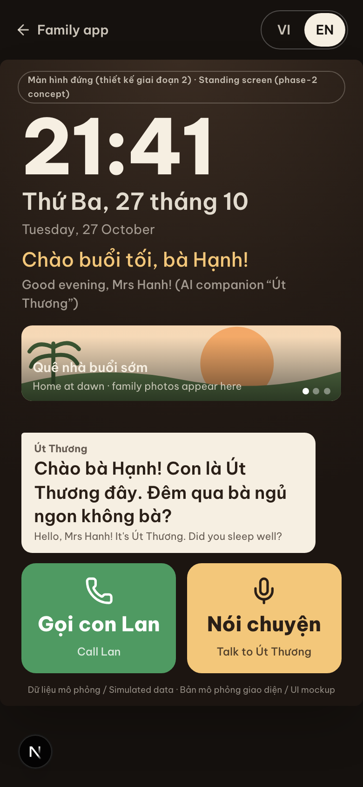
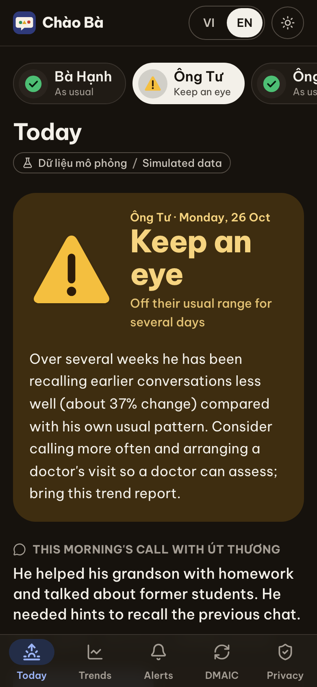

# Chào Bà

**The family's daily touchpoint on Mom's screen, with a quiet health light underneath that tells the children when she is changing and what to do.**
Prototype for the Future Health Digital Innovation Challenge 2026, challenge statement **[Population Health] Agentic AI lab for Protecting Brain Health Earlier**.

**Brain health, the gentle way:** the family's daily presence works on social isolation, one of 14 modifiable dementia risk factors (Lancet Commission 2024), and the daily voice chat yields cognitive and functional signals compared with her own usual, with clear thresholds and human review. Risk identification, never diagnosis ([how we map the statement](docs/CHALLENGE_FIT.md#3-mapping-to-the-chosen-challenge-statement)).

Vietnam has 14.2 million people aged 60+ (2024), and many live far from children who work in another city or abroad. Loneliness is itself a health risk ([TECHNICAL_DOCUMENTATION §8.4](docs/TECHNICAL_DOCUMENTATION.md#84-family-together-on-the-big-screen-cả-nhà-ghé-thăm)), and slow decline goes unnoticed until a crisis.

| Mom's standing screen | The children's app |
|---|---|
|  |  |

- **Together, with no effort for her.** Each child drops by in ten seconds a day: a photo of their lunch, a love card, a question asking for her advice. Mom only looks, or taps once. When everyone has dropped by, the screen says "Cả nhà nhớ má" (the whole family misses you).
- **A short daily chat that notices change.** Út Thương, a warm AI companion, chats with her each morning. From text and pause timings only (no audio is stored), it compares her speech, recall, symptoms and mood with **her own usual**. It shows a green / yellow / red light with a plain explanation and a next step for the family. It does not diagnose.
- **Action, then follow-up.** A shared family plan (who calls, who takes her to the doctor), a DMAIC care loop that checks whether the action worked, and a board where the commune health station reviews every red alert. A person decides on care, never the software ([intended use](docs/INTENDED_USE.md)).

### How the health light works

Út Thương, a warm Southern-Vietnamese AI companion, calls an older adult each morning over the web (prototype) or an ordinary phone (production path). From the conversation's **text and pause timings only (no audio is stored)** it tracks speech rate, pauses, filler words, vocabulary diversity, recall of yesterday's story, and self-reported symptoms and mood. After a 21-day **personal baseline**, an EWMA control chart turns these into a daily **green / yellow / red** light with a plain explanation for the adult children. A DMAIC care loop then checks whether the family's or doctor's action worked. Chào Bà reports **change relative to the person's own baseline**. It does not diagnose.

> All seeded data and all evaluation numbers are **simulated** ("Dữ liệu mô phỏng / Simulated data").
> On a held-out simulated cohort of 400 elders (alert threshold chosen on a separate development cohort):
> **64.9 % chance-corrected sensitivity** (95 % CI 57.1–72.5) for clinical-type declines. That is 79.8 % flagged by a
> matching rule within 45 days of onset, minus a 15.0 % chance rate measured on stable elders. The speech/recall
> control chart alone adds 42.7 % (33.0–51.7) beyond chance. False alarms: 0.19 (0.16–0.22) per person-month. With a population norm
> instead of a personal baseline, chance-corrected sensitivity falls to 40.1 % (30.4–49.4). An earlier "92 %" figure
> counted any alarm after onset and was inflated by chance; see [data/eval/report.md](data/eval/report.md). These are not clinical results.

## Quickstart

Requires Python 3.14, Node.js 20+, and Chrome or Edge for the voice call page.

```bash
python3.14 -m venv .venv && .venv/bin/pip install -r requirements.txt
.venv/bin/uvicorn chaoba.server.app:app --port 8000      # API + elder call page
cd web && npm install && npm run dev                      # family app (second terminal)
```

- Elder call (hands-free simulation): http://localhost:8000/call?elder=hanh&sim=1, then press **Nghe**
- Elder call (speak Vietnamese yourself): http://localhost:8000/call?elder=hanh
- Family app: http://localhost:3000/?elder=hanh (Today · Trends · Family · DMAIC · More → Alerts, Memory book, Privacy, Community; `/family` = shared family timeline, weekly synthesis, call rota, care tasks with a "Viewing as" switcher; `/community` = simulated health-station board; `/screen` is the elder's interactive 9:16 standing screen: talk to Út Thương, simulated video call, medication / mood / memory game, family love notes; hardware is phase 2)
- **Gửi yêu thương / Send some love** (Today and `/family`): one-tap cards from the children ("Má ăn cơm chưa?", "Thương má", "Hỏi ý má" for her know-how, caring tips); the elder answers with a tap on the standing screen or by voice when the morning call relays them; replies show inline and in the shared timeline, advice answers can become a "Lời má dạy" memory-book page with her consent. Free text is checked (no diagnoses, no medication advice), 6 cards per sender per day, answers are self-reports never scored, and micro-contacts are counted apart from calls (the "nobody called" nudge ignores them)
- Health check: `curl localhost:8000/api/health` → `{"ok":true,"llm":"fallback","voice":"browser"}`

Seeded dates are anchored at startup: day 90 = yesterday, so a live call is day 91 today (`CHAOBA_END_DATE=YYYY-MM-DD` pins them).

**No API key needed.** Every LLM step has a deterministic fallback. Reset demo data with `rm data/runtime/chaoba.db` (re-seeded on start).

**Claude mode is tested only with a fake client.** No API key was available while building, so the Claude conversation, post-call analysis and rewording paths are covered by unit tests with a fake client and have never run against the live API. To run a keyed session (one command), then make a call and check that `/api/health` says `"llm":"claude"` and the call record's `engine` is `claude`, not a fallback:

```bash
ANTHROPIC_API_KEY=sk-ant-... .venv/bin/uvicorn chaoba.server.app:app --port 8000
```

### With Docker

```bash
docker compose up --build    # API :8000, family app :3000, Postgres loading the production schema (chaoba/server/schema.sql)
docker compose exec -T postgres psql -U chaoba -d chaoba -v ON_ERROR_STOP=1 -f /deploy/rls_test.sql   # RLS smoke test -> RLS OK
```

Environment: `CHAOBA_CORS_ORIGINS` (origins the API accepts), `NEXT_PUBLIC_API_BASE` (API address for the browser, build time), `CHAOBA_API_INTERNAL` (API address for the Next server), `ANTHROPIC_API_KEY` (optional). The API still stores data in SQLite; Postgres is the production schema target, loaded so its Row Level Security can be inspected and tested. Verified on 27 Oct 2026 with Docker Desktop (Engine 29.1, Compose 5.0): all three services report healthy, `/api/health` answers, the family app returns 200 and renders from the API, Postgres has the 14 production tables, `rls_test.sql` prints `RLS OK`, and `.venv/bin/pytest -q tests/deploy` passes (3 tests). If ports 8000/3000/5432 are taken, set `API_PORT`, `WEB_PORT`, `PG_PORT` (and `NEXT_PUBLIC_API_BASE` / `CHAOBA_CORS_ORIGINS` to match).

## Configuration

All optional; the prototype runs with none of them.

| Variable | Default | Purpose |
|---|---|---|
| `CHAOBA_DB` | `data/runtime/chaoba.db` | SQLite path |
| `CHAOBA_END_DATE` | yesterday | pin the seeded calendar (day 90 = this date) |
| `CHAOBA_CORS_ORIGINS` | localhost, any port | allowed browser origins |
| `CHAOBA_DEMO` | `1` | demo-only endpoints (`POST /api/demo/reset`); `0` in production |
| `ANTHROPIC_API_KEY` | – | Claude conversation, analysis and rewording (deterministic fallbacks without it) |
| `CHAOBA_VOICE_ENGINE` | `browser` | `gemini` = Gemini Live voice for web calls by default (per call: `?engine=gemini`) |
| `GEMINI_API_KEY` | – | Gemini Live via the Gemini Developer API |
| `GOOGLE_GENAI_USE_VERTEXAI`, `GOOGLE_CLOUD_PROJECT`, `GOOGLE_CLOUD_LOCATION` | –, –, `us-central1` | Gemini Live via Vertex AI with Application Default Credentials |
| `CHAOBA_GEMINI_MODEL`, `CHAOBA_GEMINI_VOICE`, `CHAOBA_GEMINI_LANGUAGE_CODE`, `CHAOBA_GEMINI_SILENCE_MS` | `gemini-3.8-live`, `Sulafat`, unset, `1000` | Gemini Live settings |
| `CHAOBA_GEMINI_FAKE` | – | `1` = offline fake Gemini session (tests, muted demo); `fail` = always fails (fallback demo) |
| `NEXT_PUBLIC_API_BASE`, `CHAOBA_API_INTERNAL` | `http://localhost:8000` | API address for the browser (build time) and for the Next server |

**Optional Gemini Live voice engine** (`?engine=gemini` on `/call` and `/screen`): full-duplex Gemini voice through a server-side WebSocket proxy, with our orchestrator and safety checks still in charge; call audio then goes through our server to Google and is never stored. First live run on 4 Nov 2026 (`scripts/voice_bench.py`): the server caught 8 of 9 safety probes and Gemini told the elder to call 115 in 3 of 3 acute probes, but p90 latency was 13 s and the model skipped its control tool on 6 of 14 turns, so it is **no-go for now** and the browser voice stays the default (TECHNICAL_DOCUMENTATION.md §7.4).

## Tests and data

```bash
.venv/bin/pytest -q                        # all tests (tests/deploy skips without Docker)
.venv/bin/python scripts/gen_synth.py      # regenerate data/synth/{hanh,tu,control}.json (simulated personas)
.venv/bin/python scripts/run_eval.py       # regenerate data/eval/ (report, operating curve; simulated dev + held-out cohorts, ~20 s)
```

## Repository map

| Path | Contents |
|---|---|
| `chaoba/core/` | metrics (M1–M3), personal-baseline control chart and light rules, VI/EN explanations, DMAIC cycle, synthetic data, evaluation |
| `chaoba/agent/` | Út Thương persona and prompts, call orchestrator (scripted + Claude engines), emergency spotter, guardrails, post-call analysis, demo elder simulator, LiveKit SIP adapter (untested sketch) |
| `chaoba/server/` | FastAPI app, SQLite store, Postgres/Supabase production schema with RLS (`schema.sql`), static elder call page (`static/call.html`) |
| `web/` | Next.js family app (PWA) and the elder's interactive 9:16 standing screen (`/screen`, `web/components/elder/`, `web/lib/voice/`); offline fixtures in `web/fixtures/` (`node web/scripts/snapshot-fixtures.mjs` against a fresh API) |
| `Dockerfile`, `web/Dockerfile`, `docker-compose.yml`, `deploy/` | containers (API, standalone Next app, Postgres with the production schema), RLS smoke test `deploy/rls_test.sql`, per-call cost model `deploy/cost_model.py` |
| `docs/screenshots/` | app screenshots: `app-*.png` = first screen (390×844 @2x), `full/app-*.png` = full page |
| `data/synth/`, `data/eval/` | generated simulated personas and evaluation report |
| `scripts/` | data generation and evaluation |
| `tests/` | pytest suites for core, agent, server; `tests/deploy/` runs the RLS test on a throwaway Postgres container (skipped without Docker) |
| `CONTRACT.md` | internal build contract (types, REST API) |

## Documentation

- [docs/TECHNICAL_DOCUMENTATION.md](docs/TECHNICAL_DOCUMENTATION.md): architecture, signal definitions, control-chart method, DMAIC example, evaluation, responsible AI and data governance, deployment (containers, RLS test), per-call cost model and unit economics, **Assumptions**, **Limitations**
- [docs/DEMO_GUIDE.md](docs/DEMO_GUIDE.md): how to run it, plus a 3-minute demo script mapped to the judging criteria
- [docs/CHALLENGE_FIT.md](docs/CHALLENGE_FIT.md): judging criteria → evidence; focus-area fit; the six desired outcomes of the brain-health statement → evidence and gaps
- [data/eval/report.md](data/eval/report.md): full simulated evaluation report
