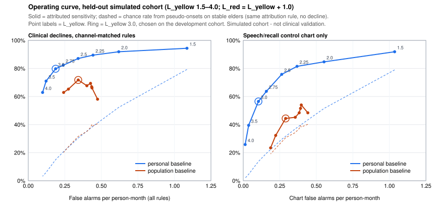

# Chào Bà – detection evaluation

> **Simulated cohort - not clinical validation.** All numbers below come from a synthetic cohort generated by `chaoba.core.synth` (AR(1) noise, weekday effects, missed/invalid calls, injected declines). They show how the pipeline behaves under stated assumptions; they are not evidence of clinical accuracy.

Held-out cohort (seed 2026): 400 simulated elders × 120 days; 124 with a clinical-type injected decline, 49 with a missed-calls decline, 227 stable. The alert threshold L_yellow = **3.0** (L_red 4.0) was chosen on a separate development cohort (seed 11, n = 200) and not re-tuned here. Baseline = first 21 days. Brackets are 95 % bootstrap intervals over people.

## Headline (held-out, corrected definition)

- **Attributed sensitivity, clinical declines** (cognitive drift, frailty/symptoms, mood/withdrawal; a channel-matched rule must start an alarm within 45 days after onset): **79.8% (72.6–86.3)**.
- **Chance rate** (same rule on stable elders at pseudo-onsets): 15.0% (11.4–18.8). **Excess (chance-corrected) sensitivity: 64.9% (57.1–72.5)**.
- **Speech/recall control chart alone**: sensitivity 56.5% (47.6–64.5), chance 13.7% (10.3–17.6), excess **42.7% (33.0–51.7)**.
- **Median delay** (attributed detections): 24 days after onset (IQR 15–29).
- **False alarms**: 0.19 (0.16–0.22) alarm episodes per person-month of stable monitoring (all rules), of which the control chart starts 0.10 (0.08–0.13); day-level specificity 97.2% (96.6–97.7); 57.7% (51.5–64.3) of stable elders never alerted in 99 monitored days.
- **Operational check, not clinical** (missed-calls declines flagged by the `unanswered` rule, which is close to circular): 71.4% (59.2–83.7), chance 6.5% (4.2–9.2).

**Definition change.** An earlier version of this report counted *any* alarm from *any* rule that started on or after the onset day, with no time limit, and pooled missed-calls declines (detected by the unanswered-calls rule, which is nearly circular) into the headline. It reported 92.0 % sensitivity. A null test (stable elders given pseudo-onsets from the real onset distribution) showed that this definition scored about 46 % "detection" with no decline at all, and only 40 of 88 detections began with a control-chart rule. Corrected: a detection must be started by a rule matching the decline's channel within 45 days of onset, the chance rate from pseudo-onsets is reported next to it, missed-calls declines are reported separately as an operational check, the threshold is chosen on a development cohort and reported on a held-out cohort, and every number carries a bootstrap interval.

## Threshold choice and operating curve

Selection rule (fixed before the held-out cohort was scored): highest excess (chance-corrected) clinical sensitivity on the development cohort with <= 0.3 all-rule false alarms per person-month; L_red = L_yellow + 1.0. On the development cohort L_yellow = 3.0 gave attributed sensitivity 84.4%, chance 9.6%, excess 74.8%, 0.17 false alarms per person-month. The control chart's shipped default is L_yellow = 3.0.

Held-out cohort, by L_yellow (L_red = L_yellow + 1). Full table incl. development cohort: `operating_curve.csv`.

| Baseline | L_yellow | Sensitivity | Chance | Excess | Chart-only sens. | Chart chance | False alarms / p-m (all) | Chart false alarms / p-m |
|---|---|---|---|---|---|---|---|---|
| personal | 1.5 | 94.4% | 79.3% | 15.0% | 91.9% | 79.0% | 1.09 | 1.04 |
| personal | 2.0 | 91.9% | 52.3% | 39.7% | 84.7% | 51.5% | 0.62 | 0.55 |
| personal | 2.25 | 89.5% | 38.8% | 50.7% | 81.5% | 37.9% | 0.44 | 0.37 |
| personal | 2.5 | 87.1% | 30.4% | 56.7% | 75.8% | 29.5% | 0.34 | 0.26 |
| personal | 2.75 | 82.3% | 20.5% | 61.8% | 63.7% | 19.5% | 0.24 | 0.16 |
| personal | 3.0 | 79.8% | 15.0% | 64.9% | 56.5% | 13.7% | 0.19 | 0.10 |
| personal | 3.5 | 71.0% | 5.9% | 65.1% | 39.5% | 4.6% | 0.12 | 0.04 |
| personal | 4.0 | 62.9% | 3.2% | 59.7% | 25.8% | 1.9% | 0.10 | 0.01 |
| population | 1.5 | 58.1% | 40.7% | 17.4% | 48.4% | 40.2% | 0.47 | 0.44 |
| population | 2.0 | 66.1% | 38.7% | 27.4% | 54.0% | 38.3% | 0.44 | 0.40 |
| population | 2.25 | 66.9% | 39.7% | 27.2% | 51.6% | 39.2% | 0.43 | 0.39 |
| population | 2.5 | 69.4% | 37.9% | 31.5% | 48.4% | 37.2% | 0.43 | 0.38 |
| population | 2.75 | 67.7% | 35.1% | 32.7% | 45.2% | 34.3% | 0.40 | 0.36 |
| population | 3.0 | 71.8% | 31.6% | 40.1% | 44.4% | 30.7% | 0.34 | 0.29 |
| population | 3.5 | 65.3% | 24.2% | 41.1% | 32.3% | 23.1% | 0.28 | 0.22 |
| population | 4.0 | 62.9% | 20.2% | 42.7% | 23.4% | 19.1% | 0.24 | 0.19 |

## By decline type

| Group | N | N clinical decline | Attributed sensitivity | Chance rate | Excess (chance-corrected) | Chart-only sensitivity | Median delay (d) | False alarms / person-month |
|---|---|---|---|---|---|---|---|---|
| cognitive_drift | 261 | 34 | 88.2% (76.5–97.1) | 14.0% (10.5–17.6) | 74.2% (62.0–84.2) | 88.2% (76.5–97.1) | 22 | 0.19 (0.15–0.23) |
| frailty_symptom | 267 | 40 | 95.0% (87.5–100.0) | 17.3% (13.1–21.2) | 77.7% (69.0–84.7) | 65.0% (47.5–80.0) | 20 | 0.19 (0.16–0.23) |
| mood_withdrawal | 277 | 50 | 62.0% (48.0–76.0) | 13.7% (10.0–17.4) | 48.3% (33.4–62.2) | 28.0% (16.0–40.0) | 28 | 0.18 (0.15–0.22) |
| missed_calls (operational) | 276 | 49 | 71.4% (59.2–83.7) | 6.5% (4.0–9.1) | 64.9% (51.6–77.8) | 10.2% (2.0–18.4) | 25 | 0.19 (0.16–0.23) |

False-alarm column per type = stable elders plus that type's pre-onset days; chance rate per type uses that type's onsets and matching rules.

## By dialect (clinical declines)

| Group | N | N clinical decline | Attributed sensitivity | Chance rate | Excess (chance-corrected) | Chart-only sensitivity | Median delay (d) | False alarms / person-month |
|---|---|---|---|---|---|---|---|---|
| central | 110 | 34 | 79.4% (64.7–91.2) | 12.4% (6.3–18.9) | 67.0% (51.3–81.1) | 58.8% (41.2–76.5) | 22 | 0.18 (0.12–0.25) |
| north | 115 | 37 | 70.3% (54.1–83.8) | 15.8% (9.1–23.0) | 54.5% (38.3–68.8) | 45.9% (29.7–62.2) | 21 | 0.19 (0.13–0.24) |
| south | 175 | 53 | 86.8% (77.4–94.3) | 15.9% (10.7–21.7) | 70.9% (60.1–80.9) | 62.3% (49.1–75.5) | 25 | 0.19 (0.15–0.23) |

## By channel (clinical declines)

| Group | N | N clinical decline | Attributed sensitivity | Chance rate | Excess (chance-corrected) | Chart-only sensitivity | Median delay (d) | False alarms / person-month |
|---|---|---|---|---|---|---|---|---|
| pstn | 248 | 74 | 78.4% (68.9–87.8) | 17.3% (12.3–22.4) | 61.1% (50.0–70.7) | 58.1% (45.9–68.9) | 22 | 0.20 (0.16–0.24) |
| web | 152 | 50 | 82.0% (70.0–92.0) | 11.0% (5.6–16.8) | 71.0% (58.0–82.8) | 54.0% (40.0–68.0) | 24 | 0.16 (0.12–0.21) |

Subgroup intervals are wide (few people per cell); differences between them are not significant.

## Personal baseline vs population norm

Same rules, thresholds and corrected detection definition; personal = each person's own 21-day baseline, population = one pooled norm (median / 1.4826*MAD over all baseline-period calls).

| Baseline | Attributed sensitivity | Chance | Excess | Chart-only excess | False alarms / p-m | Specificity (day) |
|---|---|---|---|---|---|---|
| Personal (Chào Bà) | 79.8% (72.6–86.3) | 15.0% (11.4–18.8) | 64.9% (57.1–72.5) | 42.7% (33.0–51.7) | 0.19 (0.16–0.22) | 97.2% (96.6–97.7) |
| Population norm | 71.8% (63.7–79.8) | 31.6% (26.3–37.3) | 40.1% (30.4–49.4) | 13.6% (3.3–23.2) | 0.34 (0.29–0.39) | 78.6% (75.2–81.8) |

Stable elders shown yellow/red on more than half of their monitored days: personal **0**, population norm **43** (of 227). Share of stable monitored days shown yellow/red: personal 2.8%, population 21.4%. A person already in alarm before onset cannot produce a new attributed alarm, so a population norm both raises the chance rate and hides real declines.

| Decline type | Excess sens. – personal | Excess sens. – population |
|---|---|---|
| cognitive_drift | 74.2% (62.0–84.2) | 39.8% (23.8–54.9) |
| frailty_symptom | 77.7% (69.0–84.7) | 59.0% (48.2–68.1) |
| mood_withdrawal | 48.3% (33.4–62.2) | 25.3% (11.1–39.3) |

## Which rules fired

| Rule | Started an attributed detection | False-alarm episodes (start-day rules) |
|---|---|---|
| `fall` | 6 | 4 |
| `low_mood` | 18 | 0 |
| `metric_trend` | 54 | 99 |
| `multi_symptom` | 7 | 5 |
| `symptom_repeat` | 15 | 20 |
| `unanswered` | 35 | 53 |

## Method

- Personal baseline: first 21 days (≥14 valid calls), center = median, scale = 1.4826×MAD with a per-metric floor (recall 0–3 is discrete: mean / SD). The scale is inflated (k≈1.45) for serial correlation (assumed φ=0.3) and baseline-estimation uncertainty.
- EWMA λ = 0.3 on signed z (positive = worse); limits in EWMA-sigma units: yellow 3.0, red 4.0; yellow after 3 consecutive days, red after 5; a light steps down only after 3 better days.
- Event rules: same symptom ≥2× in 7 days (yellow), ≥3 distinct symptoms in 7 days or a fall (red), 2 / 3 consecutive unanswered days (yellow / red), mood ≤2 on ≥3 of 7 days (yellow).
- Attributed detection: the first day within [onset, onset + 45] (truncated at end of follow-up) on which a matching rule starts driving a yellow/red light (it was not active the day before; an alarm already running at onset does not count). Matching rules: cognitive_drift → `metric_shift`, `metric_trend`, `multi_metric`; frailty_symptom → `fall`, `metric_shift`, `metric_trend`, `multi_metric`, `multi_symptom`, `symptom_repeat`; mood_withdrawal → `low_mood`, `metric_shift`, `metric_trend`, `multi_metric`; missed_calls → `unanswered`.
- Chance rate: for every (stable elder, decline elder) pair, the stable elder's lights are scored with the decline elder's onset day and decline type; the mean over pairs is the expected 'detection' rate without any decline. Excess sensitivity = sensitivity − chance rate.
- False alarms: alarm episodes (any rule) starting on stable monitored person-days; chart false alarms: control-chart rule starts on those days. 95 % intervals: percentile bootstrap (1 000 resamples, people resampled within clinical-decline / missed-calls-decline / stable strata, fixed seed).

_Simulated cohort - not clinical validation._
