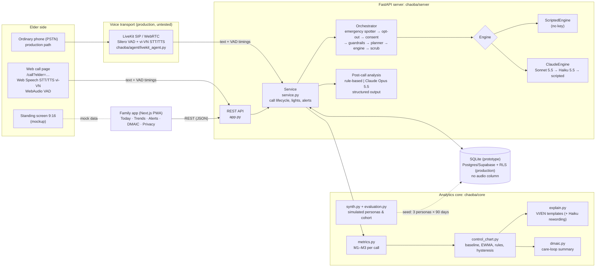
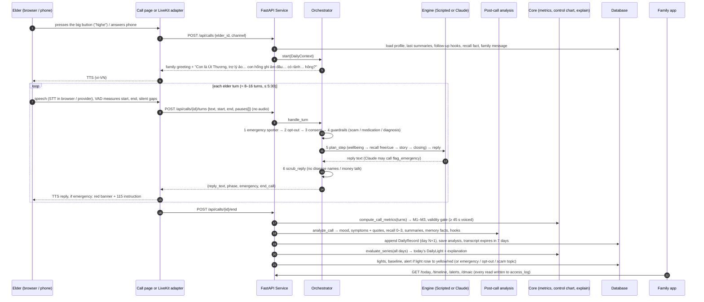

# Chào Bà: Technical Documentation

**Future Health Digital Innovation Challenge 2026** (Future Health, a Global Initiative by Abu Dhabi, with Microsoft, Inception and MBZUAI). Prototype submission, version of 27 Oct 2026.

> **What this is:** a working prototype of a daily voice check-in for older adults in Vietnam. It tracks
> **change relative to the person's own baseline** and tells the family in plain words.
> **What this is not:** a diagnostic tool. Chào Bà does not detect, diagnose or rule out any disease.
> **All evaluation numbers in this document come from simulated data** (the synthetic cohort in `chaoba.core.synth`)
> and say nothing about clinical accuracy. The UI shows "Dữ liệu mô phỏng / Simulated data" wherever data is simulated.

Related documents: [DEMO_GUIDE.md](DEMO_GUIDE.md) (how to run it, plus a 3-minute script) · [CHALLENGE_FIT.md](CHALLENGE_FIT.md) (judging criteria mapped to evidence) · [../CONTRACT.md](../CONTRACT.md) (internal API contract) · [../data/eval/report.md](../data/eval/report.md) (full evaluation report).

---

## Contents

1. [Problem and health impact](#1-problem-and-health-impact)
2. [Solution overview](#2-solution-overview)
3. [Architecture](#3-architecture)
4. [Signal pipeline: per-call metrics](#4-signal-pipeline-per-call-metrics)
5. [Personal baseline, control chart and the daily light](#5-personal-baseline-control-chart-and-the-daily-light)
6. [DMAIC Lite care loop: the Bà Hạnh worked example](#6-dmaic-lite-care-loop-the-bà-hạnh-worked-example)
7. [Conversation agent: design and guardrails](#7-conversation-agent-design-and-guardrails)
8. [Post-call analysis and family explanations](#8-post-call-analysis-and-family-explanations)
9. [Data model](#9-data-model)
10. [Evaluation on a simulated cohort](#10-evaluation-on-a-simulated-cohort)
11. [Responsible AI, safety, privacy and data governance](#11-responsible-ai-safety-privacy-and-data-governance)
12. [Scalability and deployment](#12-scalability-and-deployment)
13. [Commercial model and path to pilot](#13-commercial-model-and-path-to-pilot)
14. [Assumptions](#14-assumptions)
15. [Limitations](#15-limitations)
16. [Roadmap](#16-roadmap)
17. [References](#17-references)

---

## 1. Problem and health impact

**Context: Vietnam is ageing fast.**

| Indicator | Value | Source |
|---|---|---|
| People aged 60+ (2024) | 14.2 million | General Statistics Office (GSO) |
| People aged 60+ (2034, projected) | 20.9 million | GSO–UNFPA population projection 2024–2074 |
| "Aged society" threshold (65+ ≥ 14 % of population) | expected to be reached by 2034 | GSO–UNFPA projection |

Many older adults live alone or with an elderly spouse. Their adult children often work in Ho Chi Minh City, Hanoi or abroad. Gradual changes go unnoticed until a crisis such as a fall, a hospital admission or a family member noticing that "Mom is repeating herself". Examples are slower speech and more hesitation, worse recall, poor sleep, skipped meals, dizziness after a medication change, or withdrawal. In the weeks before the crisis, nobody was watching the trend.

**The gap Chào Bà targets**

- **Early, low-burden detection of *change*.** Formal screening such as MoCA or a clinician frailty assessment is episodic and needs a clinic visit. A short daily conversation produces a dense time series, so each person can be compared with themselves.
- **Turning a signal into action.** A flag only helps if someone acts on it. Chào Bà ties every alert to a plain-language explanation and a suggested next step. It then tracks whether the action worked, using the DMAIC loop (§6).
- **Engagement.** Older adults stop using monitoring tools that feel clinical. Chào Bà is a warm conversation in Southern Vietnamese: it asks about yesterday's story, life memories, and passes on a message from the daughter. Measurement happens passively inside that conversation.

**Clinical relevance (and its limits).** The signals we track are speech rate, pausing, filler words, vocabulary diversity, recall of a recent conversation, self-reported symptoms (dizziness, sleep, meals, falls, pain, mood, missed medication) and missed calls. The research literature has linked these to cognitive change, frailty, mood and acute illness, but **none of them has been validated for Vietnamese older adults on telephone audio** (§15). Chào Bà therefore reports only *a sustained change from this person's usual pattern*, and the recommended action is always human: call, visit, or see a doctor.

---

## 2. Solution overview

| Component | What it does | Where |
|---|---|---|
| **Út Thương** (AI companion) | 3–5 minute morning call over ordinary phone (PSTN, production path) or web (prototype). Southern Vietnamese, warm, openly a virtual assistant. Follows the phases greeting/consent → wellbeing → recall → story → closing. | `chaoba/agent/` |
| **Passive screening** | From text plus voice-activity timings only (no audio): syllables/second, pause ratio, filler rate, MATTR vocabulary diversity, recall score 0–3, self-reported symptoms, mood 1–5. | `chaoba/core/metrics.py`, `chaoba/agent/analysis.py` |
| **Personal baseline + control chart** | First 21 days form the baseline (≥ 14 valid calls). An EWMA chart on robust z-scores gives a **green / yellow / red / gray** daily light. | `chaoba/core/control_chart.py` |
| **Plain explanations** | Bilingual (VI/EN) template sentences built from the rule that fired, e.g. "Over about a week she has been speaking slower (about 9 % change) compared with her own usual pattern…". A diagnostic-word blocklist applies. | `chaoba/core/explain.py` |
| **DMAIC Lite care loop** | Define goals → Measure baseline → Analyze what changed → Improve (family/clinician decision) → Control (verify effect, set new baseline). | `chaoba/core/dmaic.py` |
| **Emergency spotter** | Keyword spotter on every utterance before any LLM, plus an LLM tool (`flag_emergency`). Calmly tells the elder to call **115**, ends the call and raises a red alert to the family. | `chaoba/agent/emergency.py` |
| **Family coordination** | Family app: today's light, trends, alerts with acknowledgement, DMAIC view, notes (including a message read to the elder at the end of the next call), privacy and consent view, access log. | `web/` (Next.js PWA) |
| **Memory book** | Life facts from calls become tomorrow's recall question and story prompts. | `memory_fact` table, `chaoba/agent/prompts.py` |
| **Standing screen** | A 9:16 home-display mockup for the elder's house. | `web/app/screen` |

Hard design rules (from `CONTRACT.md`):

1. **No raw audio stored anywhere.** The browser sends only text plus VAD timings. The schema has no audio column.
2. **Runs with no API keys.** Every LLM call has a deterministic fallback. When `ANTHROPIC_API_KEY` is set, Claude is used.
3. **Never diagnostic.** All wording describes change relative to the person's own baseline. Diagnostic labels are blocked in both agent output and family explanations.
4. **Simulated data is always flagged** (`simulated: true`, "Dữ liệu mô phỏng / Simulated data").

---

## 3. Architecture

### 3.1 Components



**Tech stack.** Python 3.14, FastAPI, Pydantic, NumPy/pandas, SQLite (prototype), Anthropic SDK (optional). Next.js 16 / React 19 / Tailwind 4 / Recharts PWA for the family app. The production voice path uses LiveKit Agents with SIP, Silero VAD and a vi-VN STT/TTS provider. The production database is Postgres on Supabase with Row Level Security (`chaoba/server/schema.sql`).

### 3.2 One call, end to end



---

## 4. Signal pipeline: per-call metrics

All per-call metrics are computed from **elder turns only**, using text plus VAD timings (`chaoba/core/metrics.py`). Times are in seconds.

**Tokenisation.** Vietnamese orthography is monosyllabic, so each whitespace token that contains at least one letter counts as one syllable. Tokens are NFC-normalised and lower-cased, with leading and trailing punctuation stripped and internal hyphens/slashes split. Pure numbers are dropped because the ASR writes them as digits and their syllable count is unknown. No word segmenter is used. Every metric is compared only against the same person's baseline computed with the same tokenizer, so a consistent unit is enough.

Let, for the elder's turns *i* in one call:
*d<sub>i</sub>* = end − start (turn duration), *g<sub>ij</sub>* = VAD silent gaps inside turn *i*,
*T* = Σ *d<sub>i</sub>* (elder turn time), *G* = Σ *g<sub>ij</sub>* over gaps with *g* ≥ 0.4 s,
*P* = Σ *g<sub>ij</sub>* over gaps with 0.4 s ≤ *g* ≤ 3.0 s, *V* = max(0, *T* − *G*) (voiced time),
*N* = number of syllable tokens, *F* = number of filler tokens.

| ID | Metric | Formula | Notes |
|---|---|---|---|
| M1 | `speech_rate_sps` | *N* / *V* | syllables per second of voiced time |
| M2a | `pause_ratio` | min(1, *P* / *T*) | gaps > 3 s are treated as disengagement or line noise: removed from voiced time but not counted as hesitation |
| M2b | `filled_pause_rate` | *F* / *N* | fillers (NFC): ờ, ơ, ờm, ơm, à, ừm, ừ, ư, ừa, ậm, ầm, ẩm, ừhm, hmm, hm, ừmm, uhm, um, mmm, ừh |
| M3 | `mattr` | moving-average type-token ratio with window *W* = 40 over lexical tokens (fillers removed): (1 / (*n* − *W* + 1)) · Σ<sub>k</sub> types(window<sub>k</sub>) / *W* | `null` if fewer than 60 lexical tokens |
| M4 | `recall_score` | 3 = free recall with ≥ 67 % of the hidden fact's keywords; 2 = partial free recall (> 0 %); 1 = correct only after the cue (keywords already given away by the cue do not count); 0 = failed; `null` = not asked | matching is diacritic-aware; accent-stripped matching is used only if the answer has no diacritics at all |
| — | **validity gate** | call is `valid` iff *V* ≥ 45 s | invalid days do not update the control chart (`invalid_reason = "too_short"`) |

**Content signals** (from `chaoba/agent/analysis.py`, rule-based fallback; Claude Opus 5.5 when a key is set):

- **Symptoms**: 7 categories (`pain`, `insomnia`, `skipped_meal`, `dizziness`, `fall`, `sadness`, `missed_medication`). Matched with a Southern-Vietnamese lexicon, sentence by sentence. Matching is **negation-aware**: a negator (`không, hổng, hông, chưa, chẳng, chả, đâu, hết, đỡ`) in the two preceding words cancels the match, so "hổng đau" is not pain. Idioms are excluded ("buồn ngủ" = sleepy, "ngã ba" = crossroads, "té ra" = it turns out). Each symptom stores verbatim quotes. The daily record stores counts.
- **Mood 1–5**: score = 3 + 0.5·min(pos, 4) − 0.5·min(neg, 4) − 0.5 [if sadness] − 0.5 [if ≥ 3 symptom types], rounded and clamped to 1..5. *pos*/*neg* are counts of positive and negative lexicon hits, and negated positives count as negative.

**Where the timings come from.**

- *Web prototype:* a WebAudio energy VAD in the page. It uses an RMS analyser, a 30 ms tick, an adaptive noise floor, threshold = max(0.012, 2.8 × floor), and requires 3 voiced frames to start an utterance. Gaps ≥ 0.4 s are sent as `pauses`. Browser Web Speech API (`vi-VN`) does STT and TTS. The analyser only reads levels; nothing is recorded or uploaded.
- *Production (sketch):* Silero VAD in LiveKit (`min_silence_duration = 0.4`) feeds `TurnTimer` (unit-tested), which produces the same `(start, end, pauses)` tuple.

---

## 5. Personal baseline, control chart and the daily light

Implementation: `chaoba/core/control_chart.py`, `ControlConfig` defaults (verified against `data/eval/report.json → config`).

### 5.1 Parameters

| Parameter | Default | Meaning |
|---|---|---|
| `baseline_days` | 21 | baseline window (calendar days from enrolment) |
| `min_valid` | 14 | valid calls needed; the window extends day by day until reached |
| `lam` (λ) | 0.3 | EWMA smoothing |
| `L_yellow` | **2.5** | chart limit, EWMA-sigma units (CONTRACT.md said 2.0, see 5.4) |
| `L_red` | **3.5** | chart limit (CONTRACT.md said 3.0) |
| `yellow_days` | 3 | consecutive valid days beyond `L_yellow` → yellow |
| `red_days` | 5 | consecutive valid days beyond `L_red` → red; also used for the multi-metric rule |
| `recover_days` | 3 | consecutive better valid days before the light steps down |
| `z_clip` | 6.0 | per-day z clipped to ±6 |
| `assumed_phi` (φ) | 0.3 | assumed AR(1) serial correlation of daily data |
| `sigma_floor` | speech rate 0.15 syll/s · pause ratio 0.015 · filler rate 0.006 · MATTR 0.012 · recall 0.5 points | minimum scale |
| symptom / mood windows | 7 days | see rules |
| `rebaseline_mode` | `trailing` | new baseline from the 21 days before the re-baseline day |

### 5.2 Method

For each metric *m* ∈ {speech rate, pause ratio, filler rate, MATTR, recall}, with bad direction *d<sub>m</sub>* (−1 = lower is worse for speech rate, MATTR, recall; +1 = higher is worse for pause ratio, filler rate):

1. **Baseline** from valid days in the window: *c* = median, *s* = max(1.4826 · MAD, floor). For recall, a discrete ceiling-bound 0–3 score, *c* = mean and *s* = max(SD, 0.5).
2. **Variance inflation** for serial correlation and for estimating the baseline from only *n* = 14–21 calls:
   *k*² = (1 + φ(1 − λ)) / (1 − φ(1 − λ)) + (π/2) / (*n* · λ / (2 − λ)).
   With φ = λ = 0.3, *k* ≈ 1.40 for *n* = 21 and ≈ 1.47 for *n* = 14. Without it, the chart statistic on stable simulated people had SD ≈ 1.6 instead of 1.
3. **Signed z** (positive = worse): *z<sub>t</sub>* = *d<sub>m</sub>* · (*x<sub>t</sub>* − *c*) / (*s* · *k*), clipped to [−6, 6].
4. **EWMA**: *e<sub>t</sub>* = λ *z<sub>t</sub>* + (1 − λ) *e*<sub>*t*−1</sub>, *e*<sub>0</sub> = 0 when monitoring starts. Days without a valid value carry *e* forward.
   **Chart statistic** = *e<sub>t</sub>* / √(λ / (2 − λ)) = *e<sub>t</sub>* / 0.420. Only the worse direction alerts.
5. **`change_pct`** shown to families = (mean of the metric's last 7 valid values − *c*) / |*c*| × 100.

### 5.3 Light rules

A "metric-yellow day" is a valid day with chart statistic ≥ `L_yellow`. Runs count consecutive *valid* days, and missed or invalid days do not break a run.

| Light | Rule (reason code) | Needs baseline? |
|---|---|---|
| **gray** | baseline not ready (`building_baseline`), or no valid call today (`missed_call` / `invalid_call`) **and** nothing alarming is held | — |
| **green** | baseline ready, valid call, no rule fired | yes |
| **yellow** | any metric ≥ 2.5 for ≥ 3 consecutive valid days (`metric_trend`) | yes |
| | same symptom reported ≥ 2 times in the last 7 days (`symptom_repeat`) | no |
| | 2 consecutive unanswered days (`unanswered`) | no |
| | mood ≤ 2 on ≥ 3 of the last 7 days (`low_mood`) | no |
| **red** | ≥ 2 metrics each metric-yellow for ≥ 5 days (`multi_metric`) | yes |
| | one metric ≥ 3.5 for ≥ 5 consecutive valid days (`metric_shift`) | yes |
| | a fall reported today (`fall`) | no |
| | ≥ 3 distinct symptoms in the last 7 days (`multi_symptom`) | no |
| | 3 consecutive unanswered days (`unanswered`) | no |
| **red (live)** | emergency detected during a call (`emergency`), which overrides the computed light | no |

**Safety first:** event rules (symptoms, fall, unanswered, mood) apply during baseline building too.

**Hysteresis.** The light rises immediately. It steps down only after 3 consecutive valid days at a lower raw level, and then only to the highest level seen in those days. While an alarm is held, the earlier reasons stay visible with a `recovering` reason ("2 better day(s) so far; still watching"). A missed call shows gray only if the held level is green. An active red is never hidden behind gray because the elder missed one call.

**Re-baselining** (DMAIC Control step). `rebaseline_days=[d]` re-estimates the baseline from the 21 days before *d*, restarts the EWMA and clears held alarms. Accepting a new normal is a deliberate care-team decision. If that window is too sparse, a forward baseline is built while the old one keeps monitoring.

### 5.4 Why the limits differ from the contract

With five metric channels on the simulated cohort, the contract's 2.0 / 3.0 limits gave about 0.57 false alarms per person-month (per the module docstring). Moving to 2.5 / 3.5 halved that to 0.29 with almost the same sensitivity (§10). `ControlConfig(L_yellow=2.0, L_red=3.0)` reproduces the contract values. The limits were tuned on simulated data and **must be re-tuned on real data** (§15).

---

## 6. DMAIC Lite care loop: the Bà Hạnh worked example

DMAIC (Define–Measure–Analyze–Improve–Control) is the Six Sigma improvement cycle. Chào Bà uses a light version so a family can see *what changed, what they did, and whether it worked*. `chaoba/core/dmaic.py → compute_cycle()`:

| Phase | Span | Content |
|---|---|---|
| **Define** | day 1 | care concern and goals agreed with the family |
| **Measure** | days 1 … baseline end | number of valid calls, baseline speech rate, mean recall |
| **Analyze** | first yellow/red after baseline … day before intervention | which signals changed and by how much, symptoms mentioned, context note |
| **Improve** | intervention day … first day of a run of ≥ 7 green/gray days | what the family or clinician did, pre/post effect, days to green. With no intervention yet, this shows the *recommended* action. |
| **Control** | green day … last day | continued monitoring; **new baseline** = green day + 21, or a care-team-chosen day |

**Effect estimate.** Mean of valid values in the 14 days before the intervention vs. 14 days starting after a washout of 7 days, shown next to the original baseline median.

### Bà Hạnh (simulated persona: 72, Bến Tre, lives alone, hypertension, Amlodipine 5 mg at 07:00)

Story: a blood-pressure medication change on day 30 is followed by dizziness, poorer sleep, skipped meals, slower and more hesitant speech, and weaker recall. Her daughter Lan takes her to the doctor on day 44, the dose is adjusted, and Lan starts calling three times a week. All values below are taken from `data/synth/hanh.json` (seed 7) and are **simulated**. Day 1 = 2026-08-22.

| Day (date) | Event | Light | Why (reason codes) |
|---|---|---|---|
| 1 (22 Aug) | Daily calls start. **Define:** "blood pressure, sleep and memory while living alone"; goals: sleep 6 h, take BP medication on time, keep memory stable | gray | `building_baseline` |
| 1–21 | **Measure:** 20 valid calls, 0 missed. Baseline speech rate 4.57 syll/s, mean recall 2.67/3 | gray | |
| 22 | Personal baseline ready | green | |
| 30 (20 Sep) | Doctor changes BP medication (family note) | green | |
| 35 | First mention of dizziness when standing up | green | |
| **38** (28 Sep) | Dizziness mentioned a 2nd time in 7 days | **yellow** | `symptom_repeat` |
| 40 | Speech-rate trend beyond limit 3 days (−8.6 %) | yellow | `metric_trend`, `symptom_repeat` |
| 41 | Pause ratio also trending (+21.8 %) | yellow | 2× `metric_trend` |
| **43** (3 Oct) | 3 distinct symptoms in 7 days (dizziness, poor sleep, skipped meal); filler rate +32 % | **red** | `multi_symptom` + trends |
| **44** (4 Oct) | **Improve:** doctor visit, dose adjusted; daughter calls 3×/week | red | `multi_metric`, `metric_shift` (speech rate −14.6 %) |
| 44–52 | Signals recover; light held red by the lagging EWMA and hysteresis | red → | `recovering` from day 51 |
| 53–55 | Stepped down | yellow | residual speech-rate trend, `recovering` |
| **56** (16 Oct) | **Back to green, 12 days after the intervention** | green | |
| **77** (6 Nov) | **Control:** new personal baseline from the stable post-intervention period | green | `rebaseline` |
| 90 (19 Nov) | Still green | green | |

Light timeline (days 1–90; `.` gray, `g` green, `Y` yellow, `R` red):

```
day  1  ..........  11 ..........  21 .ggggggggg  31 gggggggYYY  41 YYRRRRRRRR
day 51  RRYYYggggg  61 gg.ggggggg  71 ggggg.gggg  81 gg.ggggggg
```

**Intervention effect** (pre = days 30–43, post = days 51–64; simulated):

| Signal | Baseline (median, days 1–21) | Pre | Post | Change |
|---|---|---|---|---|
| Speech rate (syll/s) | 4.57 | 4.18 | 4.61 | +10.2 % |
| Pause ratio | 0.113 | 0.131 | 0.117 | −10.7 % |
| Filler rate | 0.046 | 0.054 | 0.047 | −12.2 % |
| MATTR | 0.710 | 0.699 | 0.707 | +1.2 % |
| Recall (0–3) | 3.0 | 2.33 | 2.77 | +18.7 % |

What the family read on day 44 (generated by the template, English version):
> *"Over two weeks she has been speaking slower (about 15% change) and pausing more (about 40% change) compared with her own usual pattern, and mentioned dizziness 3 times. In the last 7 days she mentioned 3 different health complaints: dizziness, poor sleep, skipped meals. Please call her and consider arranging a doctor's visit."*

The two other personas show the remaining cases:

- **Ông Tư** (76, HCMC): a slow drift in recall and word use from about day 30. The light turns **yellow on day 65** (recall −37 %, pause ratio +18 %) and stays yellow to day 90. There is no intervention yet, so the Improve phase shows the *recommendation*: "book a neurology check-up to assess memory; family to talk with him more often". The recommendation is for a check-up, not a diagnosis.
- **Ông Bảy** (69, Cần Thơ): the stable control. Green on all 63 monitored days with a valid call; gray only on missed or short-call days.

---

## 7. Conversation agent: design and guardrails

### 7.1 Persona and call structure

**Út Thương** ("youngest, beloved child") is a warm Southern (miền Tây) virtual companion. She addresses the elder as *bà/ông*, calls herself *con*, and uses particles such as *nha, nghen, hông, nè*. Rules: **at most 20 words per turn and exactly one question per turn**; no lists, emoji or English, because replies are spoken by TTS. She always discloses that she is a virtual assistant (*trợ lý ảo*). Prompt version: `ut-thuong-2026.10.1`.

| Phase | Content | Control |
|---|---|---|
| greeting | recorded-style family greeting ("(Lan nhắn) Má ơi, Lan nè…"), AI disclosure, "con hổng ghi âm đâu" (no recording), **verbal consent**: "có rảnh nói chuyện với con chừng năm phút hông?" | "no" → polite goodbye; recorded as an unanswered day |
| wellbeing | sleep → food → how they feel (one at a time) | |
| recall | free recall of a fact from 1–2 days ago (or a curated profile fact), then one cue if needed | scored 3/2/1/0 (§4) |
| story | follow-up hook from earlier calls, or a life-story prompt (memory book) | ≤ 4 story turns |
| closing | medication reminder (exact text from the profile), family message, goodbye | at 270 s (4:30) or 16 elder turns; hard stop at 330 s (5:30) |

### 7.2 Processing order for every elder turn (`Orchestrator.handle_turn`)

1. **Layer-1 emergency spotter** (always first, deterministic, < 1 ms). Southern-Vietnamese lexicon in 8 categories: chest pain, breathing, fall, syncope, stroke signs, seizure, heavy bleeding, self-harm. Matching keeps diacritics ("té" = fall must not fire on "kinh tế" = economy). Negation is handled ("hổng có té"), and idioms are excluded ("té ra", "ngã ba", "sợ té", "mệt muốn chết" = dead tired). On a hit, the agent gives a calm instruction to **call 115** or a neighbour and says the family is being told. The call ends and a **red emergency alert** with the verbatim quote is created. Self-harm gets a gentler message plus 115.
2. **Opt-out** ("đừng gọi nữa", "không muốn nói chuyện"…) → confirmation question → recorded opt-out, scheduling stops (`POST /api/calls` returns 409), and a yellow `opt_out` alert asks the family to check in. `POST /api/elders/{id}/resume` records a new consent row.
3. **Consent** answer in the greeting phase.
4. **Deterministic guardrails** (do not advance the plan):
   - *anti-scam*: bank, transfer, OTP, password, prize, "công an gọi", e-wallets → refuses, warns never to give codes by phone, and raises a `scam_topic` alert to the family;
   - *no medication changes*: stop/double/change medicine → "hỏi bác sĩ";
   - *no diagnosis*: "tui bị bệnh gì?" → "con là trợ lý ảo, con hổng biết khám bệnh…".
5. **Planner** (`plan_step`): time- and turn-based phase machine (§7.1).
6. **Engine reply**: `ScriptedEngine` (no key; varied, phase-aware Southern Vietnamese with keyword reactions, deterministic per call) or `ClaudeEngine`.
7. **Output scrub**: any reply containing a disease name (e.g. *sa sút trí tuệ, mất trí nhớ, alzheimer, trầm cảm, parkinson, đột quỵ, tai biến, ung thư, tiểu đường, suy tim*) or money/OTP terms is replaced by a safe neutral prompt.

### 7.3 Claude engine (when `ANTHROPIC_API_KEY` is set)

- Conversation model `claude-sonnet-5-5`, then `claude-haiku-5-5`, then `ScriptedEngine` on error, refusal or empty output. Timeout is 12 s per request; effort is low.
- The static persona prompt is **cached** (`cache_control`). Per-call context (profile, goals, medication schedule, last 3 summaries, hooks, recall question/cue/hidden answer, family message) goes in a second, uncached system block. The per-turn phase directive is appended last, so the cached prefix stays byte-stable.
- **Layer-2 emergency**: a strict `flag_emergency` tool (category enum + verbatim quote). The LLM can *add* an emergency the keyword list missed; it cannot remove a Layer-1 hit.
- These paths are covered by unit tests with a fake client (cache control, tool call, fallback chain, scrubbing). They have **not** been exercised against the live API in this environment (§15).

---

## 8. Post-call analysis and family explanations

**Post-call analysis** (`chaoba/agent/analysis.py`) produces a `CallAnalysis` with: 1–2 sentence summaries (VI/EN), mood 1–5, symptoms with verbatim quotes, recall score and cue level, up to 2 new memory facts and 2 follow-up hooks, an emergency flag, and the prompt version.

- **No key:** the transparent rule-based analyser described in §4.
- **With key:** `claude-opus-5-5` with **JSON-schema structured output** (strict schema, all 7 symptom keys required), 60 s timeout. Instructions forbid diagnosis and require verbatim quotes. Safety nets: the deterministic emergency flag is OR-ed in (the LLM can never clear it), the output is re-checked against the forbidden-word list, and any error falls back to the rule-based result.

**Family explanations** (`chaoba/core/explain.py`):

- **Templates first.** The structured reasons become fixed bilingual sentences: span ("over about a week"), what changed (at most 2 metrics, speech rate and recall first, % rounded), symptoms, mood, recovery status, and a **next step** matched to severity. Examples: "call today or tomorrow"; "call now and ask someone nearby to check in person" after a fall; "consider arranging a doctor's visit"; for cognitive-only changes, "consider calling more often and booking a neurology check-up to look at her memory".
- **Blocklist.** Templates and any LLM text must not contain *sa sút trí tuệ, alzheimer, trầm cảm, dementia, depression, parkinson, đột quỵ, stroke, mất trí, chẩn đoán, diagnos\**.
- **Optional rewording** with `claude-haiku-5-5` (only for the newest light after a live call). It is accepted only if it introduces **no number that is not in the template**, contains no blocklisted word, and is at most 2 × template length + 80 characters. Otherwise the template is used.

---

## 9. Data model

Shared types (`chaoba/core/models.py`): `Turn`, `CallMetrics`, `CallAnalysis`, `DailyRecord` (one per elder per day; the unit of the control chart), `DailyLight`.

Tables (SQLite in the prototype, `chaoba/server/db.py`; the Postgres/Supabase production schema with the same names is in `chaoba/server/schema.sql`):

| Table | Purpose | Retention / notes |
|---|---|---|
| `elder` | profile (honorific, age, province, dialect, channel, conditions, medications, goals), `opted_out`, `simulated` | while enrolled |
| `family_member` | linked people and role: `primary`, `viewer`, `clinician` | |
| `consent` | append-only consent rows: kind, granted, by whom, witness, scope (VI/EN), timestamp | kept as audit trail |
| `call_session` | channel, start/end, end reason, emergency, prompt version, engine, **transcript (text + timings) with `transcript_expires_at` = +7 days** | transcript nulled after expiry. **No audio column.** |
| `call_analysis` | `CallAnalysis` + `CallMetrics` per call | derived; includes symptom quotes (see §15) |
| `memory_fact` | life facts (profile or call), recall question/cue/keywords | memory book |
| `metric_daily` | `DailyRecord` | derived numbers while enrolled |
| `baseline` | center/scale per metric (per segment in production) | |
| `daily_light` | light, reasons, EWMA z per metric, explanations | |
| `alert` | yellow/red alerts, type, explanation, acknowledged by | |
| `dmaic_cycle` | Define inputs, intervention day, re-baseline days, cycle result | |
| `family_note` | notes; `to_elder` notes are read at the end of the next call | |
| `access_log` | every family read/write: actor, role, action, resource, time | |
| `care_event` | timeline events (medication change, doctor visit, re-baseline…) | prototype only |

REST API: see `CONTRACT.md`. Extensions beyond the contract: `POST /api/elders/{id}/resume`, `GET /api/calls/{id}/simulate` (demo only), and `to_elder` on notes.

---

## 10. Evaluation on a simulated cohort

> **Simulated cohort, not clinical validation.** These numbers show that the pipeline behaves as designed on
> data we generated ourselves. They are **not** evidence of real-world sensitivity, specificity or clinical benefit.
> Source: `data/eval/report.md` / `report.json`, reproducible with `.venv/bin/python scripts/run_eval.py` (seed 11, < 1 s; output verified identical).

### 10.1 Cohort and definitions

- **200 simulated elders × 120 days.** 88 have an injected decline (onset day 35–85, gradual ramp of 14–35 days, random magnitude 0.3–1.2) and 112 are stable. Baseline = first 21 days.
- Generative model per metric: personal level × weekday effect × (1 + AR(1) noise, φ = 0.3) × decline effect. There are about 3 % missed and 3–5 % short calls, and rare background symptom mentions. Dialect (south 45 %, central 25 %, north 30 %) sets the population speech-rate mean (4.6 / 4.3 / 4.9 syll/s). The **PSTN channel and central dialect get extra measurement noise**, an assumption meant to mimic 8 kHz audio and weaker ASR.
- Decline types: `cognitive_drift` (recall, MATTR, pauses, fillers), `frailty_symptom` (speech rate, pauses, mood, pain/dizziness/sleep/meal/fall mentions), `mood_withdrawal` (mood, sadness, short calls), `missed_calls`.
- **Sensitivity**: decline elders with an alarm episode (run of yellow/red days) starting on or after onset. **Detection delay**: first such episode start − onset. **False alarms**: episodes starting on stable person-days, per 30 monitored days. **Specificity**: person-level = stable elders never alerted; day-level = stable monitored days not yellow/red.

### 10.2 Headline (simulated)

| Metric | Value |
|---|---|
| Sensitivity (decline flagged after onset) | **92.0 %** (76.1 % within 30 days) |
| Median detection delay | **19 days** after onset (IQR 11–29) |
| False alarms | **0.29 per person-month** of stable monitoring; 0.183 of these come from the speech/recall control chart, the rest from event rules (falls, repeated symptoms, missed calls) |
| Day-level specificity | **95.4 %** |
| Person-level specificity | **42.0 %** of stable elders never alerted in 99 monitored days |

**Read this candidly:** 0.29 false alarms per person-month means a typical stable family gets about **one yellow/red light every 3–4 months** that does not reflect a real change. Most stable elders (58 %) see at least one over 99 days. That is acceptable only because the action for yellow is "give her a call", which is low-cost and arguably useful anyway. Event-rule alerts such as a reported fall are things a family would want to hear regardless.

### 10.3 By decline type (simulated)

| Group | N | N decline | Sensitivity | Sens. ≤30 d | Median delay (d) | Specificity (person) | Specificity (day) | False alarms / person-month |
|---|---|---|---|---|---|---|---|---|
| All | 200 | 88 | 92.0% | 76.1% | 19 | 42.0% | 95.4% | 0.29 |
| cognitive_drift | 17 | 17 | 100.0% | 94.1% | 18 | n/a | 92.2% | 0.449 |
| frailty_symptom | 29 | 29 | 93.1% | 86.2% | 18 | n/a | 94.2% | 0.416 |
| missed_calls | 24 | 24 | 87.5% | 62.5% | 20 | n/a | 95.5% | 0.294 |
| mood_withdrawal | 18 | 18 | 88.9% | 61.1% | 29 | n/a | 95.1% | 0.31 |
| stable | 112 | 0 | n/a | n/a | n/a | 42.0% | 95.7% | 0.268 |

### 10.4 Ablation: personal baseline vs population norm (simulated)

Same rules and thresholds. *Personal* = each person's own 21-day baseline. *Population* = one pooled norm (median / 1.4826·MAD over all baseline-period calls).

| Baseline | Sensitivity | Sens. ≤30 d | Median delay (d) | Specificity (person) | Specificity (day) | False alarms / person-month |
|---|---|---|---|---|---|---|
| **Personal (Chào Bà)** | **92.0%** | **76.1%** | 19.0 | 42.0% | **95.4%** | **0.29** |
| Population norm | 76.1% | 60.2% | 17.0 | 43.8% | 67.8% | 0.435 |

| Decline type | Sensitivity, personal | Sensitivity, population |
|---|---|---|
| cognitive_drift | 100.0% | 82.4% |
| frailty_symptom | 93.1% | 69.0% |
| missed_calls | 87.5% | 75.0% |
| mood_withdrawal | 88.9% | 83.3% |

- Stable elders shown yellow/red on **more than half** of their monitored days: personal **0**, population **38 of 112**.
- Share of stable monitored days shown yellow/red: personal **4.6 %**, population **32.2 %**.
- The population norm's slightly better person-level specificity and shorter delay are artefacts. People already in permanent alarm cannot generate a *new* episode, so they are not counted as false alarms, and declines that start while someone is already flagged are not counted as detections.

**Why it matters.** Speech rate, pauses and vocabulary differ much more *between* people (dialect, education, personality, phone line) than a meaningful change *within* one person. A population norm keeps naturally slow speakers permanently flagged and misses a 10–15 % decline in a fast speaker who is still "above average". In the simulation this is the core design argument for the personal baseline. **It is a property of how we built the simulation and must be confirmed on real data.**

### 10.5 Fairness by dialect and channel (simulated)

| Group | N | N decline | Sensitivity | Sens. ≤30 d | Median delay (d) | Specificity (person) | Specificity (day) | False alarms / person-month |
|---|---|---|---|---|---|---|---|---|
| central | 49 | 20 | 100.0% | 75.0% | 16 | 44.8% | 95.3% | 0.289 |
| north | 61 | 25 | 92.0% | 84.0% | 18 | 38.9% | 94.7% | 0.312 |
| south | 90 | 43 | 88.4% | 72.1% | 22 | 42.6% | 96.0% | 0.275 |
| pstn | 127 | 55 | 94.5% | 78.2% | 18 | 40.3% | 94.9% | 0.319 |
| web | 73 | 33 | 87.9% | 72.7% | 19 | 45.0% | 96.3% | 0.238 |

Day-level specificity stays within 94.7–96.3 % across groups, and false alarms within 0.24–0.32 per person-month. With a personal baseline, between-group level differences cancel by construction. Sensitivity differences are within what small subgroups (20–55 declines) produce by chance. **Caveat:** the dialect/channel effects in the simulation are our *assumptions* (noise multipliers). Real fairness depends on vi-VN STT accuracy for each dialect, age group and phone line, which we have not measured (§15). A real study must report these breakdowns.

### 10.6 Which rules fired (simulated)

| Rule | First alert of detected declines | False-alarm episodes |
|---|---|---|
| `metric_trend` | 40 | 87 |
| `unanswered` | 20 | 19 |
| `symptom_repeat` | 13 | 24 |
| `low_mood` | 4 | 0 |
| `fall` | 3 | 6 |
| `multi_symptom` | 2 | 2 |

### 10.7 Software verification

- `.venv/bin/pytest -q` → **107 tests pass** (core metrics, control chart, explanations and blocklist, synthetic personas, DMAIC/evaluation, emergency spotter true/false positives including idioms and negation, orchestrator phases, consent/opt-out, scam/medication/diagnosis guardrails, Claude engine with a fake client, server API end-to-end including "no audio anywhere").
- A full hands-free simulated web call was run through the API: 10 elder turns, recall failed free and succeeded after the cue (score 1), 67 s voiced speech (valid), day 91 appended, light computed.

---

## 11. Responsible AI, safety, privacy and data governance

### 11.1 Safety by design

| Risk | Control in the prototype |
|---|---|
| Missed emergency | Layer-1 keyword spotter runs before any LLM on every turn; Layer-2 LLM tool can only add; 115 instruction; red alert with quote; call ends |
| Diagnostic or alarming language | System prompt rule + output scrub (agent) + blocklist (family explanations, LLM rewording, analysis summaries); "change relative to the person's own baseline" wording throughout |
| Medication harm | Never advises starting/stopping/changing medication; refers to the doctor; reminders read the exact profile schedule |
| Scams targeting older adults | Refuses money/OTP topics, warns the elder, alerts the family |
| Over-alerting / alarm fatigue | Personal baseline, variance inflation, 3/5-day runs, hysteresis; false-alarm rate reported openly (§10) |
| Under-alerting (long gaps) | Unanswered 2/3 days → yellow/red; red never hidden behind gray |
| LLM failure or hallucination | Deterministic fallbacks at every LLM call; numbers in rewording must match the template; LLM cannot clear emergency flags |
| Deception | Agent discloses it is a virtual assistant in every greeting and when asked |
| Autonomy | Daily verbal consent; in-call opt-out with confirmation; scheduling stops; family is told so they can ask why |

Clinical safety is *human-in-the-loop by design*. Chào Bà never takes a clinical action. The red light, the emergency alert and the 115 instruction all route to people. The Improve step of DMAIC is a decision taken by the family or clinician.

### 11.2 Consent flow

1. **Enrolment** (with the elder, a family member as witness). Separate, revocable consents are stored as rows: `daily_call` (receive calls), `voice_metrics` (derive timing metrics from text and timings, no audio), `family_sharing` (share the light and summaries), `clinician_sharing` (share reports with a clinician on family request), `research_use` (de-identified research use, **off by default**).
2. **Every call:** AI disclosure, "no recording" notice, and a consent question. Declining ends the call politely and counts as an unanswered day.
3. **Any time:** the elder can say "đừng gọi nữa" (confirmed, recorded, scheduling stops), or the family can withdraw consent in the Privacy screen. In the prototype this only changes the displayed state; no data is deleted.

### 11.3 Data minimisation and retention

- **No raw audio** is stored or transmitted by the prototype. The browser VAD only reads levels, and STT happens in the browser. There is no audio column in either schema, and a server test asserts this.
- **Transcripts** (text + timings) expire after **7 days**. They are purged on startup and after each call (prototype) or by a daily `pg_cron` job (production).
- **Derived numbers** (metrics, lights, baselines) are kept while enrolled, because the personal baseline needs history.
- Families see **summaries, lights and explanations**. Under RLS, transcripts are visible only to the primary carer and the elder.
- Every family read is written to the **access log**, which is shown in the Privacy screen.

### 11.4 Roles and Row Level Security (production schema)

| Data | `primary` (main carer) | `viewer` (other family) | `clinician` | `elder_self` |
|---|---|---|---|---|
| Profile | read, update | read | read **if `clinician_sharing` consent** | read, update |
| Transcripts (`call_session`) | read | — | — | read |
| Summaries, metrics, baselines, DMAIC | read | read | read if consent; DMAIC write | read |
| Daily light, alerts | read, acknowledge | read, acknowledge | read | read |
| Memory facts | read | — | — | read |
| Notes | read, write own | read, write own | read, write own | read notes addressed to them |
| Consent changes | insert | — | — | insert |
| Access log | read | — | — | read |

RLS uses helper functions `app_role()`, `can_read()` and `clinician_shared()` (the latest `clinician_sharing` consent row). In the prototype there is **no authentication**: the role comes from an `X-Role` header (§15).

### 11.5 Cross-border processing and Vietnamese law

- **No-key mode** sends nothing to third parties; all processing stays on the server.
- **Claude mode** sends transcript text and the per-call context (first name, honorific, age, province, medication schedule, family first names, recent summaries) to Anthropic's API, outside Vietnam. That is a **cross-border transfer of health-related personal data**. Before any real deployment we plan to:
  - minimise and pseudonymise the context (no full names, coarse location);
  - evaluate whether a domestic or in-region LLM, or fully scripted conversation with only post-call analysis via an LLM, meets quality needs;
  - prepare the documentation the law requires for processing and cross-border transfer of sensitive data.
- **Applicable framework (to be confirmed with Vietnamese counsel):** the **Personal Data Protection Law No. 91/2025/QH15** (effective 1 January 2026) and its implementing **Decree 356/2025/ND-CP**. Health data is sensitive personal data and needs explicit consent, impact assessments and cross-border transfer documentation. Medical-device rules: **Decree 98/2021/ND-CP**. As built, Chào Bà is a wellbeing and family-communication service that makes no diagnostic claims. Any claim of screening for a condition would likely bring it under medical-device classification. We have **not** made a formal classification determination.
- Hosting: production data in a Vietnam-region or contractually compliant Postgres (Supabase or self-hosted), encrypted at rest and in transit, with service-role keys only on the server.

---

## 12. Scalability and deployment

### 12.1 Path from prototype to production

| Layer | Prototype (works today) | Production path |
|---|---|---|
| Voice transport | Browser page: Web Speech API (vi-VN STT/TTS) + WebAudio VAD | **LiveKit Agents**: outbound SIP calls to ordinary phones via a domestic SIP trunk; Silero VAD; vi-VN STT/TTS provider (candidates: Deepgram, Google, FPT.AI). Adapter `chaoba/agent/livekit_agent.py` is a sketch: import-guarded, `TurnTimer` unit-tested, **otherwise untested** |
| Orchestration | In-process `Orchestrator`, call state in memory | Same code; call state in Redis or a sticky worker per LiveKit room; one job = one call |
| Scheduling | Manual (click "Nghe") | `pg_cron` / worker creates rooms and dials at each elder's preferred time; checks `opted_out` and consent first; retry policy for unanswered calls |
| Store | SQLite file | **Postgres on Supabase** with RLS (`schema.sql`), Supabase Auth for families, `pg_cron` purge |
| Family app | Next.js PWA against REST; falls back to bundled fixtures if the API is down | Same, behind auth; push notifications for red/emergency alerts; Zalo/SMS channel for families |
| Analytics | `evaluate_series` recomputes the full series per call (milliseconds for 90–365 days) | Same; incremental update possible; nightly batch for population-health dashboards |

**Load profile.** Calls are short (4–5 min), bounded and cluster in the morning. 10,000 elders calling between 7 and 9 am average about 330 calls in progress at once (10,000 × 4 min / 120 min ≈ 333), each needing STT + TTS + about 10 LLM turns. Workers scale horizontally (stateless apart from the per-call state). Post-call analysis is asynchronous. Database writes are a few rows per call.

### 12.2 Cost model (estimates, not quotes)

Per 4-minute call, from the concept planning estimates:

| Channel | Per call | Per person-month (30 calls) | Per person-month (5 calls/week ≈ 21.5) |
|---|---|---|---|
| Web (STT/TTS + LLM) | ~US$0.10–0.25 | ~US$3–7.5 | ~US$2.2–5.4 |
| Domestic PSTN (+ telephony minutes) | ~US$0.20–0.45 | **~US$6–14** | ~US$4.3–9.7 |

**Target:** under about 100,000 VND per person-month (≈ US$4 at an assumed 25,000–26,000 VND/USD) for the B2C price point. Reaching it on PSTN requires:

- `claude-haiku-5-5` (or the scripted engine) for the conversation, keeping Opus for the single post-call analysis or replacing it with Haiku plus the rule-based analyser;
- prompt caching, which is already implemented;
- domestic vi-VN STT/TTS at volume pricing;
- volume SIP telephony rates;
- fewer calls per week where the family chooses.

These are planning ranges that must be replaced by measured cost per call in the pilot.

---

## 13. Commercial model and path to pilot

| Segment | Buyer | Offer | Notes |
|---|---|---|---|
| **B2C** | adult children (often in cities or abroad) | monthly subscription: daily calls, light, alerts, notes, memory book | price target < 100k VND/month needs the cost levers in §12.2 |
| **B2G** | commune health stations / district health centres | population-level view of enrolled older adults (share green/yellow/red, missed calls); prioritised outreach list | supports prevention and screening; requires government procurement and data-sharing agreements |
| **B2B** | insurers, hospitals (post-discharge follow-up) | 30–90 day post-discharge check-in with escalation to the care team | value case: earlier contact before readmission; must be shown in a pilot |

**Competitive landscape** (based on public product descriptions; verify before quoting):

| Product | What it is | Difference from Chào Bà |
|---|---|---|
| ElliQ | companion device for older adults | needs dedicated hardware; English-first; companionship focus. Chào Bà uses an ordinary phone, Vietnamese, and links the call to a family care loop |
| Winterlight Labs | speech-based cognitive assessment | clinical-trial / clinic assessment tasks; not a daily companion; not Vietnamese |
| Sonde Health | voice biomarkers for health/mental-health signals | SDK/platform; acoustic features. Chào Bà uses text+timing features and personal baselines, no audio stored |
| Medication-reminder and fall-detection apps | reminders, alarms | smartphone or wearable needed; event-driven, no trend detection or conversation |

**Path to pilot**

1. **Now (prototype):** working web call, analytics, family app, simulated evaluation.
2. **Usability pilot (about 10–20 families, 4–6 weeks):** web plus a first PSTN integration. Measure call completion, opt-out, call length, voiced seconds per call (validity rate), STT word error rate on consented samples, family response to alerts, and cost per call.
3. **Validation study (50–100 older adults):** with a geriatrics department in Ho Chi Minh City, after ethics board approval. Reference standards: MoCA and clinician frailty assessment at baseline and follow-up. Outcomes: test–retest reliability of each metric, association of within-person change with change in the reference measures, alert agreement with clinician judgement, false-alarm rate in real use, and subgroup results by dialect, channel, sex, age and education. Report per **STARD** (diagnostic accuracy) and **TRIPOD** (prediction models). Re-tune limits on real data with a held-out set.
4. **Service pilot:** one B2B (post-discharge) or B2G (commune health station) site with defined escalation pathways and a medical-device regulatory assessment.

---

## 14. Assumptions

1. Older adults (or their families on their behalf) will accept a daily 3–5 minute call from an AI companion that discloses it is virtual, and keep answering for months. Engagement features (memory book, family messages, recall game) are assumed to help; this is untested.
2. A within-person change in speech timing, filler use, vocabulary diversity and recall, *measured from STT text and VAD timings*, carries a useful signal about changes in wellbeing, cognition or frailty in Vietnamese older adults. This has not been validated.
3. Valid measurement needs at least 45 s of the elder's voiced speech per call, and 14 valid calls in the first 21 days are enough for a usable baseline.
4. Daily metrics follow roughly AR(1) noise with φ ≈ 0.3 around a stable personal level. Typical day-to-day relative SDs are speech rate 4.5 %, pause ratio 12 %, filler rate 18 %, MATTR 2.5 % (synthetic-data parameters). Declines unfold over 2–5 weeks.
5. PSTN audio and Central dialects add measurement noise (simulation noise multipliers 1.15–1.3); dialect sets population speech-rate means of 4.3–4.9 syll/s. These numbers are assumptions, not measurements.
6. Self-reported symptoms, falls and mood in conversation are reasonably honest and stable enough to trend.
7. Families will act on yellow/red with a call, visit or doctor appointment, and will record interventions so the Improve/Control steps can be evaluated.
8. Planning cost ranges per call (§12.2) and an exchange rate of about 25,000–26,000 VND/USD.
9. Vietnam demographic figures are as published by GSO and the GSO–UNFPA projection (§1).

---

## 15. Limitations

**Evidence**

- **All performance numbers are from simulated data** that we generated, with declines we injected using models we chose. The good sensitivity, the personal-vs-population ablation and the fairness tables show internal consistency, not real-world accuracy. Signal sizes for the three demo personas were tuned so their stories land on target days (the rules were not tuned per persona).
- **Vietnamese voice and language markers are not clinically validated.** No reference-standard comparison (MoCA, frailty assessment) has been done.
- **False alarms are not negligible:** 0.29 per person-month (simulated), so about one non-actionable alert every 3–4 months per stable person, and 58 % of stable simulated elders saw at least one in 99 days. Real-world rates may be higher.
- **Detection is slow by design:** median 19 days after onset (simulated). This is a trend detector, not an acute-event detector; emergencies rely on the spotter and on what the elder says.
- Limits (2.5 / 3.5) were tuned on the same simulated cohort they are evaluated on.

**Measurement**

- **STT accuracy** for older Southern (and other) speakers over 8 kHz phone lines is unknown. STT errors distort syllable counts, fillers (often dropped by STT), MATTR and recall matching. Per-person baselines absorb constant bias, not variable error.
- **Browser dependency:** the web prototype relies on the Web Speech API (best in Chrome/Edge, needs network STT and an installed vi-VN voice) and on a simple energy VAD. Pause measurement is affected by background noise, echo cancellation and STT segmentation.
- The **hands-free sim mode** measures the *browser TTS* reading simulated lines, not a person. Its day-91 metrics are not meaningful as speech data, so such calls are stored `simulated: true` (see DEMO_GUIDE.md).
- **Frailty and mood signals come only from self-report** and a simple lexicon-based mood heuristic. No gait, grip, weight or objective measures are used.
- Symptom and emergency lexicons cover common Southern phrasings. Other dialects, code-switching and indirect phrasing will be missed (the Layer-2 LLM tool helps only in Claude mode).
- MATTR needs ≥ 60 lexical tokens; short or taciturn speakers get no M3.

**Engineering**

- **LiveKit/SIP adapter is untested.** `livekit-agents` is not installed and no SIP trunk or STT/TTS credentials exist. PSTN is the intended main channel but is not demonstrated.
- **Claude mode is not verified against the live API** in this environment. It is unit-tested with a fake client only, and API errors silently fall back to Haiku, then to the scripted engine. Check the `engine` field of the call record to know which engine actually answered.
- **No authentication in the prototype.** Roles come from unauthenticated `X-Actor` / `X-Role` headers and every caller is treated as the primary carer. RLS exists only in the production schema and has not been tested against a live Supabase instance.
- Active call state is in memory (single process); a server restart drops calls in progress.
- Retention gaps: `call_analysis` keeps verbatim symptom quotes, and `memory_fact` keeps elder sentences, beyond the 7-day transcript window. Emergency and scam alerts quote the elder verbatim to the family. These need an explicit retention rule.
- The family app's "withdraw consent" is a display-only demo; nothing is deleted.
- Not yet assessed: accessibility for hearing-impaired users, ethnic-minority languages, and elders with established cognitive impairment (who may not consent meaningfully on their own).

---

## 16. Roadmap

| Horizon | Work |
|---|---|
| Before submission (20 Nov 2026) | Demo hardening; real-browser microphone tests; README/docs |
| 0–3 months | LiveKit SIP integration with a domestic trunk; vi-VN STT/TTS selection by measured word error rate on consented elderly speech; Supabase Auth + RLS tests; pseudonymised LLM context; cost-per-call telemetry; data-retention rules for quotes and memory facts |
| 3–6 months | Usability pilot (10–20 families); ethics submission; regulatory assessment under Decree 98/2021 and PDPL documentation |
| 6–18 months | Validation study (50–100 elders, HCMC geriatrics department) vs MoCA and clinician frailty assessment; STARD/TRIPOD reporting; re-tuned limits; subgroup fairness report |
| 18+ months | B2B post-discharge and B2G commune health station pilots; population-health dashboard (aggregate, de-identified); additional dialects |

---

## 17. References

Only sources named in the concept document are listed. Where we are not certain of a stable URL, the source is named without a link.

1. General Statistics Office of Vietnam (GSO). Population statistics, 2024 (people aged 60+: 14.2 million). https://www.gso.gov.vn
2. GSO and UNFPA Viet Nam. Population projection for Viet Nam 2024–2074 (20.9 million aged 60+ by 2034; aged society by 2034). https://vietnam.unfpa.org
3. Law on Personal Data Protection No. 91/2025/QH15 (effective 1 January 2026).
4. Decree No. 356/2025/ND-CP (implementing the Law on Personal Data Protection).
5. Decree No. 98/2021/ND-CP on the management of medical devices.
6. STARD 2015: Standards for Reporting Diagnostic Accuracy Studies. https://www.equator-network.org/reporting-guidelines/stard/
7. TRIPOD: Transparent Reporting of a multivariable prediction model for Individual Prognosis Or Diagnosis. https://www.tripod-statement.org
8. Montreal Cognitive Assessment (MoCA). https://mocacognition.com
9. Future Health Digital Innovation Challenge 2026 (Future Health, a Global Initiative by Abu Dhabi; with Microsoft, Inception, MBZUAI), hosted on Hack2skill.
10. Product references (public product descriptions; verify): ElliQ (Intuition Robotics), Winterlight Labs, Sonde Health.
